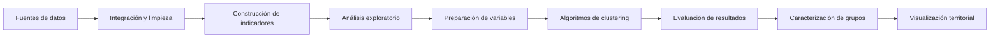

<div align="center">

# Agrupamiento de municipios mediante algoritmos de aprendizaje no supervisado según la incidencia de doce delitos en Guatemala


<p>
Proyecto de análisis de datos orientado a identificar patrones de similitud en la incidencia delictiva de los municipios de Guatemala.
</p>

</div>

---

##  Descripción

La criminalidad constituye un fenómeno complejo que presenta diferencias importantes entre territorios. Aunque existen registros públicos relacionados con la incidencia delictiva, su análisis mediante estadísticas descriptivas puede limitar la identificación de patrones y comportamientos compartidos entre municipios.

Este proyecto aplica técnicas de **análisis de datos** y **aprendizaje automático no supervisado** para explorar la incidencia de distintos delitos en los municipios de Guatemala.

A partir de indicadores comparables, se evalúan diferentes algoritmos de agrupamiento con el propósito de identificar conjuntos de municipios que presentan comportamientos delictivos similares.

Los resultados buscan contribuir a una comprensión territorial del fenómeno criminal mediante análisis estadístico, agrupamiento de datos y recursos de visualización.

---

##  Objetivo

Identificar agrupamientos de municipios de Guatemala mediante algoritmos de
aprendizaje no supervisado, según la incidencia de doce delitos correspondientes al
período 2022–2025.

---

##  ¿Qué realiza el proyecto?

El proyecto desarrolla un flujo de trabajo que contempla:

* Integración de información delictiva y poblacional.
* Limpieza, transformación y validación de los datos.
* Construcción de indicadores comparables entre municipios.
* Exploración estadística de la información.
* Estandarización de las variables utilizadas.
* Aplicación de algoritmos de agrupamiento.
* Evaluación interna de los resultados.
* Caracterización de los grupos identificados.
* Representación visual y territorial de los agrupamientos.

---

##  Enfoque metodológico

El estudio utiliza técnicas de **clustering** para descubrir estructuras internas en los datos sin depender de categorías previamente definidas.

Cada municipio se representa mediante un conjunto de indicadores relacionados con su incidencia delictiva. A partir de estos indicadores, los algoritmos analizan la similitud entre municipios y los organizan en grupos con características comunes.

<div align="center">



</div>

---

##  Etapas generales

### 1. Preparación de datos

Se integran los registros procedentes de diferentes fuentes, se revisa su calidad y se homologan las variables necesarias para el análisis.

### 2. Construcción de indicadores

Los datos delictivos se relacionan con información poblacional para generar indicadores que permitan comparar municipios con diferentes cantidades de habitantes.

### 3. Análisis exploratorio

Se estudia la distribución de las variables, la presencia de valores atípicos, las diferencias entre municipios y las posibles relaciones entre los indicadores.

### 4. Agrupamiento

Se aplican distintos algoritmos de aprendizaje no supervisado para identificar estructuras y patrones de similitud en los datos.

### 5. Evaluación

Los resultados se comparan mediante métricas internas que consideran la cohesión de los municipios dentro de cada grupo y la separación entre agrupamientos.

### 6. Interpretación

Los grupos obtenidos se caracterizan de acuerdo con sus indicadores predominantes y se representan mediante recursos estadísticos y geoespaciales.

---

##  Tecnologías

El proyecto utiliza principalmente herramientas del ecosistema de Python para análisis de datos, aprendizaje automático y visualización.

| Área                         | Herramientas                          |
| ---------------------------- | ------------------------------------- |
| Lenguaje                     | Python                                |
| Manipulación de datos        | Pandas, NumPy                         |
| Análisis estadístico         | SciPy                                 |
| Aprendizaje automático       | Scikit-learn                          |
| Visualización                | Matplotlib, Seaborn                   |
| Análisis geoespacial         | GeoPandas                             |
| Entorno de desarrollo        | Jupyter Notebook / Visual Studio Code |
| Visualización complementaria | Tableau                               |

> Las tecnologías y librerías pueden cambiar conforme avance el desarrollo del proyecto.

---

##  Evaluación de los agrupamientos

La calidad de los resultados se analiza mediante diferentes métricas internas de evaluación, entre ellas:

* Coeficiente de Silhouette.
* Índice Davies-Bouldin.
* Índice Calinski-Harabasz.

Además de las métricas cuantitativas, se considera la estabilidad, distribución e interpretabilidad de los grupos generados.

La selección del resultado más apropiado no depende únicamente de una métrica aislada, sino de la coherencia general de los agrupamientos y de su utilidad para comprender el comportamiento territorial de los datos.

---

##  Visualización de resultados

Los agrupamientos se representan mediante diferentes recursos visuales, como:

* Gráficos comparativos.
* Perfiles de indicadores por grupo.
* Diagramas de distribución.
* Matrices de correlación.
* Representaciones de los algoritmos.
* Mapas coropléticos municipales.

La visualización geoespacial permite observar cómo se distribuyen los agrupamientos en el territorio nacional y facilita la identificación de posibles patrones de concentración, similitud o dispersión.

---

##  Estructura prevista del repositorio

```text
.
├── data/
│   ├── raw/                 # Datos originales
│   ├── processed/           # Datos limpios y transformados
│   └── external/            # Fuentes complementarias
│
├── notebooks/
│   ├── exploratory/         # Análisis exploratorio
│   ├── preprocessing/       # Preparación de datos
│   └── modeling/            # Pruebas de agrupamiento
│
├── src/
│   ├── data/                # Carga y procesamiento
│   ├── features/            # Construcción de indicadores
│   ├── models/              # Algoritmos y evaluación
│   └── visualization/       # Recursos gráficos
│
├── outputs/
│   ├── figures/             # Gráficos generados
│   ├── maps/                # Visualizaciones territoriales
│   └── reports/             # Resultados y reportes
│
├── requirements.txt
├── LICENSE
└── README.md
```

> La estructura puede modificarse conforme se incorporen nuevos componentes al proyecto.

---

##  Estado del proyecto

El proyecto se encuentra actualmente **en desarrollo**.

Las actividades principales comprenden la preparación de las fuentes de información, definición de indicadores, análisis exploratorio, evaluación de algoritmos y diseño de los recursos de visualización.

### Progreso general

* [x] Definición del problema de investigación.
* [x] Delimitación territorial y temporal.
* [x] Selección inicial de variables.
* [ ] Integración definitiva de fuentes.
* [ ] Validación y limpieza de datos.
* [ ] Construcción de indicadores.
* [ ] Análisis exploratorio.
* [ ] Implementación de algoritmos.
* [ ] Evaluación de agrupamientos.
* [ ] Caracterización de resultados.
* [ ] Elaboración del mapa coroplético.
* [ ] Documentación final.

---

##  Resultados esperados

El proyecto busca generar:

* Un conjunto de datos integrado y preparado para análisis.
* Indicadores delictivos comparables entre municipios.
* Una comparación estructurada de algoritmos de agrupamiento.
* Grupos de municipios con comportamientos delictivos similares.
* Una caracterización descriptiva de cada agrupamiento.
* Visualizaciones que faciliten la interpretación de los resultados.
* Una representación territorial mediante mapas municipales.

---

##  Consideraciones

Los agrupamientos obtenidos representan similitudes estadísticas entre municipios y no deben interpretarse automáticamente como categorías absolutas de peligrosidad o seguridad.

Los resultados dependen de las fuentes disponibles, las variables seleccionadas, el período analizado y las decisiones metodológicas adoptadas.

El proyecto posee un enfoque exploratorio y analítico. Su propósito es apoyar la comprensión territorial de la incidencia delictiva, no explicar por sí solo las causas sociales, económicas o institucionales asociadas con la criminalidad.

---

##  Contribuciones

Actualmente, el repositorio forma parte de un proyecto académico en desarrollo.

Las observaciones, recomendaciones metodológicas y propuestas de mejora son bienvenidas. Antes de realizar cambios importantes, se recomienda abrir un **issue** para documentar y discutir la propuesta.

---

##  Uso académico

Este repositorio se desarrolla con fines académicos y de investigación.

Cuando se utilicen resultados, código o documentación derivados del proyecto, se recomienda citar adecuadamente el repositorio y las fuentes originales de información.

---

##  Autora

**Michelle Mejía**

Proyecto académico de análisis de datos, aprendizaje automático no supervisado y visualización territorial.

---


<div align="center">


Este repositorio se actualiza conforme avanza la investigación.

</div>
