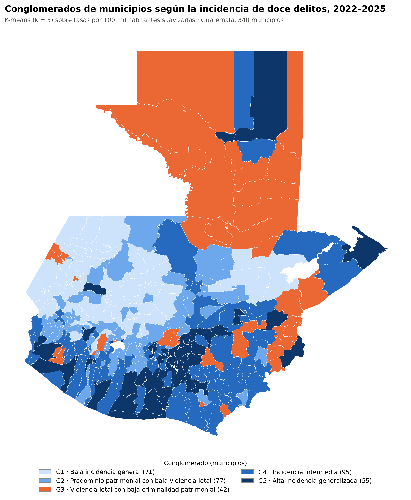
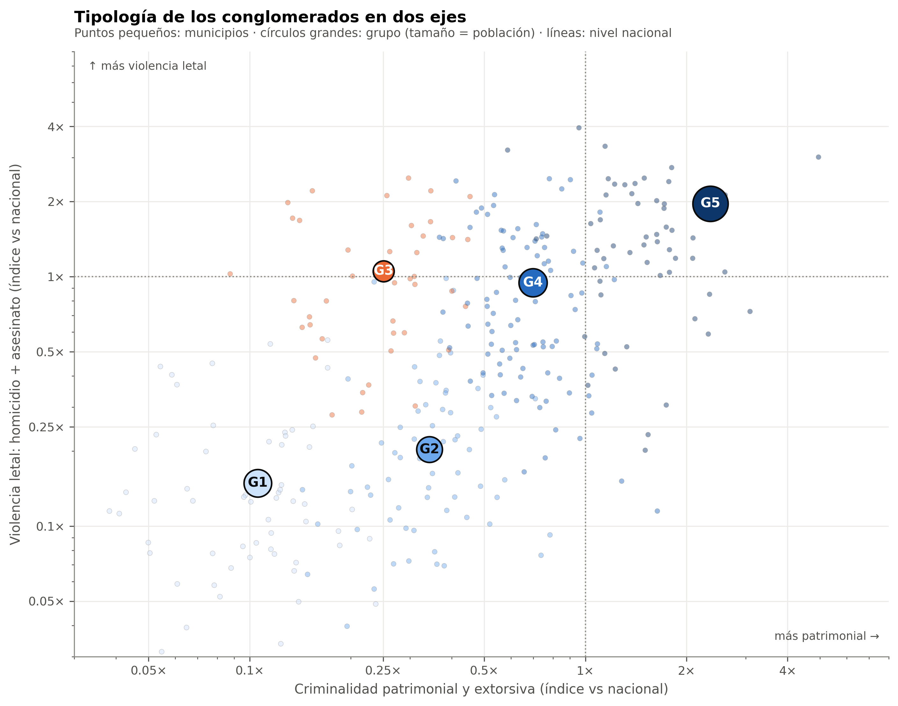
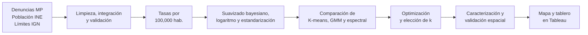

<div align="center">

# Agrupamiento de municipios según la incidencia de doce delitos en Guatemala

**Aprendizaje no supervisado aplicado a las denuncias del Ministerio Público, 2022–2025**


Trabajo de graduación · Ingeniería en Ciencia de la Computación y Tecnologías de la Información · Universidad del Valle de Guatemala

**[Ver el tablero interactivo en Tableau Public](https://public.tableau.com/app/profile/michelle.villela/viz/DashboardIncidenciaCriminal/Dashboard2)**

</div>

---

## Contenido

- [Resumen](#resumen)
- [Resultados](#resultados)
- [Metodología](#metodología)
- [Datos](#datos)
- [Estructura del repositorio](#estructura-del-repositorio)
- [Cómo reproducir el análisis](#cómo-reproducir-el-análisis)
- [Tablero interactivo](#tablero-interactivo)
- [Limitaciones y uso responsable](#limitaciones-y-uso-responsable)
- [Cómo citar](#cómo-citar)

---

## Resumen

¿Qué municipios de Guatemala tienen perfiles delictivos parecidos? Este proyecto responde esa pregunta con algoritmos de agrupamiento aplicados a los **340 municipios** del país y a las denuncias de **doce delitos** registradas por el Ministerio Público (MP) entre 2022 y 2025:

> homicidio · asesinato · robo · robo agravado · hurto · hurto agravado · extorsión · violación · violación agravada · violación con circunstancias especiales de agravación · agresión sexual · agresión sexual con agravación de la pena

Las denuncias se convierten en tasas por cada 100,000 habitantes, se estabilizan con un suavizado bayesiano empírico y se agrupan con **K-means**, elegido tras compararlo con un modelo de mezclas gaussianas (GMM) y el agrupamiento espectral.

> [!NOTE]
> Los datos son **denuncias registradas**, no la totalidad de los delitos ocurridos. Los conglomerados describen patrones de denuncia y no son etiquetas de peligrosidad de los municipios ni de su población.

---

## Resultados

Los municipios forman un **continuo de incidencia** y no grupos aislados. La partición en cinco conglomerados es una segmentación estable de ese continuo, que se distingue en dos ejes: **criminalidad patrimonial y extorsiva** y **violencia letal**.

<div align="center">

</div>

| | Conglomerado | Municipios | % población | % denuncias | Índice patrimonial | Índice letal |
| --- | --- | ---: | ---: | ---: | ---: | ---: |
| G1 | Baja incidencia general | 71 | 19.5 | 2.9 | 0.11 | 0.15 |
| G2 | Predominio patrimonial con baja violencia letal | 77 | 17.0 | 6.2 | 0.34 | 0.20 |
| G3 | Violencia letal con baja criminalidad patrimonial | 42 | 11.3 | 3.8 | 0.25 | 1.05 |
| G4 | Incidencia intermedia | 95 | 20.4 | 15.0 | 0.70 | 0.95 |
| G5 | Alta incidencia generalizada | 55 | 31.9 | 72.2 | 2.36 | 1.96 |

<sub>Índice = tasa del conglomerado entre la tasa nacional (1 = igual al país). Los porcentajes pueden no sumar 100 por redondeo.</sub>

**Hallazgos principales**

- **G5** reúne al 32 % de la población y al 72 % de las denuncias, con tasas de 2 a 2.6 veces la nacional en robos, hurtos y extorsión. Se ubica en el corredor central y la costa sur.
- **G3** tiene violencia letal en el nivel nacional, pero pocas denuncias patrimoniales. Se concentra en Petén, Chiquimula, Zacapa y Jalapa, y no aparece con solo tres conglomerados.
- **G1** registra muy pocas denuncias, sobre todo en Huehuetenango y Quiché. Puede reflejar menos delitos o menos denuncia; los datos no permiten distinguirlo.
- Las **denuncias por extorsión** aumentan entre 53 % y 129 % en todos los conglomerados entre 2022 y 2025.
- Aunque el modelo no recibe información geográfica, el 46 % de los pares de municipios vecinos comparte conglomerado, frente al 21 % esperado al azar.

<div align="center">

</div>

**Modelo final**

| Parámetro | Valor |
| --- | --- |
| Algoritmo | K-means, k = 5, inicialización k-means++, 500 reinicios, semilla 42 |
| Variables | 10 tasas suavizadas (los tres delitos sexuales agravados sumados en una), con ln(1 + x) y estandarización |
| Silueta media | 0.175 (separación moderada) |
| Estabilidad *bootstrap* (ARI) | 0.798 |
| Jaccard por conglomerado | 0.795 a 0.929 |
| Municipios con silueta negativa | 8 (2.4 %) |

---

## Metodología



1. **Integración.** Se cruzan las denuncias del MP con las proyecciones de población del INE mediante el código geográfico de cada municipio. Doce nombres se homologan con un diccionario explícito, sin coincidencias aproximadas.
2. **Indicadores.** Para cada municipio y delito se calcula la tasa anual del período como la suma de denuncias entre la suma de persona-años, por 100,000.
3. **Preparación.** Un suavizado bayesiano empírico (Marshall, 1991) reduce el ruido de los municipios pequeños; después se aplican ln(1 + x) y la estandarización.
4. **Comparación de algoritmos.** K-means, GMM y espectral se evalúan con silueta, Davies-Bouldin, Calinski-Harabasz y estabilidad *bootstrap*.
5. **Elección de k.** Se exigen criterios mínimos de estabilidad (Jaccard ≥ 0.75), silueta negativa y tamaño, y luego se elige la solución con perfiles más diferenciados. k = 5 es una solución de compromiso orientada a la interpretación; k = 3 obtiene mejores métricas internas.
6. **Caracterización.** Los conglomerados se describen con las tasas observadas de los doce delitos y se contrastan en el territorio con pruebas de *join counts* e índice de Moran.

---

## Datos

| Archivo | Fuente | Contenido |
| --- | --- | --- |
| `data/raw/denuncias_2022_2025.csv` | Ministerio Público (SIFT), mediante solicitud de acceso a la información pública | 75,973 registros: departamento, municipio, año, mes, grado, delito y cantidad de denuncias (435,043 en total) |
| `data/raw/Estimaciones-y-Proyecciones-Municipales-2015-2035.xlsx` | Instituto Nacional de Estadística (INE) | Proyecciones de población municipal, base censo 2018 |
| `data/raw/municipios_guatemala.geojson` | Instituto Geográfico Nacional (IGN), vía IDEG-SEGEPLAN | Límites municipales de 2021 |

El resultado final por municipio está en `data/processed/resultado_agrupamiento.csv` y, con todas las tasas e índices, en `outputs/tableau/tableau_municipios.csv`.

Los datos son públicos y se incluyen con fines académicos. Al reutilizarlos, cite a las instituciones de origen.

---

## Estructura del repositorio

```text
.
├── data/
│   ├── raw/            # Datos originales (MP, INE e IGN)
│   ├── processed/      # Bases integradas, tasas, matrices y resultado del agrupamiento
│   └── external/       # Capa geográfica con códigos del INE
├── notebooks/
│   ├── exploratory/    # 01–03: análisis exploratorio e integración
│   ├── preprocessing/  # 04: suavizado, transformación y representaciones
│   └── modeling/       # 05–08: algoritmos, comparación, optimización y caracterización
├── src/
│   ├── preprocesamiento.py  # Suavizado bayesiano empírico y transformaciones
│   ├── modelos.py           # Métricas, estabilidad bootstrap, gap y Jaccard
│   └── utilidades.py        # Rutas, catálogos de delitos, colores y estilo de figuras
├── outputs/
│   ├── figures/        # Figuras de cada cuaderno
│   ├── reports/        # Decisiones y métricas de cada etapa (CSV y JSON)
│   └── tableau/        # Datos del tablero y guía de uso
├── documentos anexos/  # Protocolo del trabajo de graduación
├── requirements.txt
├── LICENSE
└── README.md
```

---

## Cómo reproducir el análisis

```bash
git clone https://github.com/michellemej22596/TrabajoProfesional-AgrupamientoDeMunicipiosSegunIncidencia.git
cd TrabajoProfesional-AgrupamientoDeMunicipiosSegunIncidencia
pip install -r requirements.txt
jupyter notebook
```

Ejecute los cuadernos en orden. Cada uno lee los resultados del anterior, y las decisiones de cada etapa se guardan en `outputs/reports/`.

| Cuaderno | Contenido |
| --- | --- |
| `01_EDA_denuncias_MP` | Calidad, distribución y concentración de las denuncias |
| `02_EDA_poblacion_INE` | Reestructuración y análisis de las proyecciones de población |
| `03_EDA_integrado_tasas` | Integración de fuentes, tasas, ruido y tendencia al agrupamiento |
| `04_preprocesamiento` | Suavizado, transformación, escalado y representaciones |
| `05_exploracion_algoritmos` | Pruebas de algoritmos y tratamiento de los delitos de baja frecuencia |
| `06_comparacion_modelos` | Comparación de K-means, GMM y agrupamiento espectral |
| `07_optimizacion` | Hiperparámetros, sensibilidad y elección de k |
| `08_caracterizacion` | Perfiles, nombres, evolución, mapas, validación espacial y exportación a Tableau |

**Entorno utilizado:** Python 3.14.3, pandas 3.0.2, NumPy 2.4.4, SciPy 1.17.1, scikit-learn 1.8.0, Matplotlib 3.10.9 y openpyxl 3.1.5, en Windows 11. Los procesos aleatorios usan la semilla 42.

**Control:** al terminar, `data/processed/resultado_agrupamiento.csv` debe tener 340 municipios con 71, 77, 42, 95 y 55 municipios en G1 a G5.

---

## Tablero interactivo

<div align="center">

</div>

El [tablero en Tableau Public](https://public.tableau.com/app/profile/michelle.villela/viz/DashboardIncidenciaCriminal/Dashboard2) reúne:

- el mapa de conglomerados;
- una ficha por municipio: conglomerado, tasa total, veces la tasa nacional, posición entre los 340 municipios, población y variación 2022–2025;
- el perfil de cada conglomerado frente a la tasa nacional;
- el peso de cada conglomerado en población y denuncias.

Las tasas de grupos de municipios se calculan como la suma de denuncias entre la suma de persona-años, igual que en Python. Los datos y la guía de construcción están en `outputs/tableau/`.

---

## Limitaciones y uso responsable

- **Denuncias, no delitos:** la cifra negra puede variar entre territorios, en especial en los municipios de baja incidencia registrada.
- **Ubicación:** no se confirmó si el municipio registrado corresponde siempre al lugar del hecho o al de la fiscalía receptora.
- **Denominador:** la población residente puede no coincidir con la población expuesta en municipios con comercio, tránsito o turismo.
- **Sensibilidad:** la partición con k = 5 cambia parcialmente con escalado robusto (ARI 0.58) o PCA (ARI 0.63).
- **Escala:** los resultados son municipales y no se trasladan a comunidades ni a personas.

Los conglomerados son un insumo descriptivo. Usarlos para estigmatizar territorios contradice el propósito del estudio.

---

## Cómo citar

> Mejía Villela, M. (2026). *Agrupamiento de municipios mediante algoritmos de aprendizaje no supervisado según la incidencia de doce delitos en Guatemala* [Trabajo de graduación, Universidad del Valle de Guatemala]. https://github.com/michellemej22596/TrabajoProfesional-AgrupamientoDeMunicipiosSegunIncidencia

---

## Licencia

El código se distribuye bajo la [licencia MIT](LICENSE). Los datos pertenecen a sus instituciones de origen.

## Autora

**Michelle Mejía Villela** · Universidad del Valle de Guatemala · 2026
